<p align="center">
  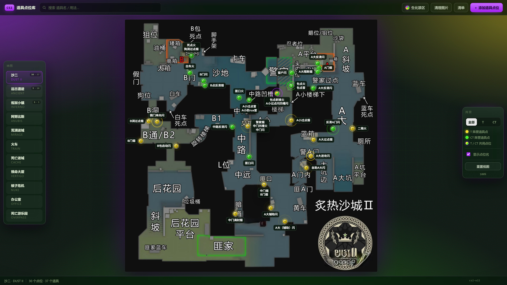
</p>

<h1 align="center">CS2 道具点位库</h1>

<p align="center">
  面向个人的 CS2 道具点位管理工具。在雷达图上标注站位，为每个站位挂载烟、闪、火、雷，<br>
  记录描点截图、投掷方式与站位说明。数据保存在项目目录的 JSON 文件中。
</p>

<p align="center">
  
  
  
  
</p>

<p align="center">
  简体中文 · <a href="README.md">English</a>
</p>

---

## 项目概述

本工具管理个人的 CS2 道具点位，对应三类实际需求：点位信息散落在录像与截图里，难以按图检索；同一站位上的多个道具缺少统一记录；描点图、投掷方式与站位说明三者之间没有对应关系。

实现形态是原生 HTML、CSS、JavaScript 编写的单页应用，配合一个只依赖 Python 标准库的本地服务。服务负责三件事：发送静态文件、读写 `data.json`、保存上传的截图。项目不使用框架、不需要构建、不依赖 npm 与 CDN，也没有账号体系，全部数据保存在本机磁盘。

仓库自带 11 张地图、38 个点位、52 个道具的示例数据（烟 17、闪 21、火 11、雷 3），共引用 63 张描点截图。这份数据可以直接作为内容库使用，也可以清空后录入自己的点位。

设计范围限定为单人单机：不提供多用户访问、云端同步与冲突合并。

## 界面预览

**查看道具**：左侧列出该站位下的全部道具与站位说明，右侧是描点图，底部显示使用方式。

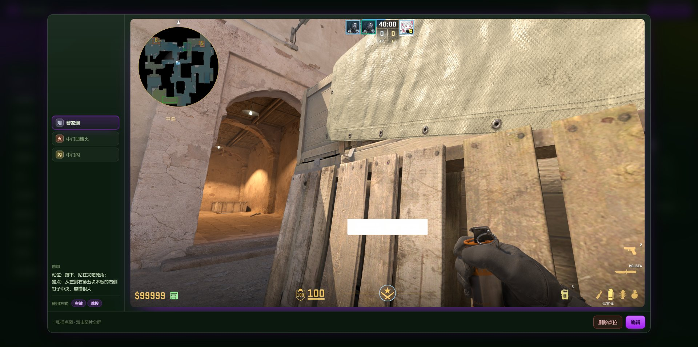

**编辑点位**：右侧停靠面板，地图保持可点选状态。

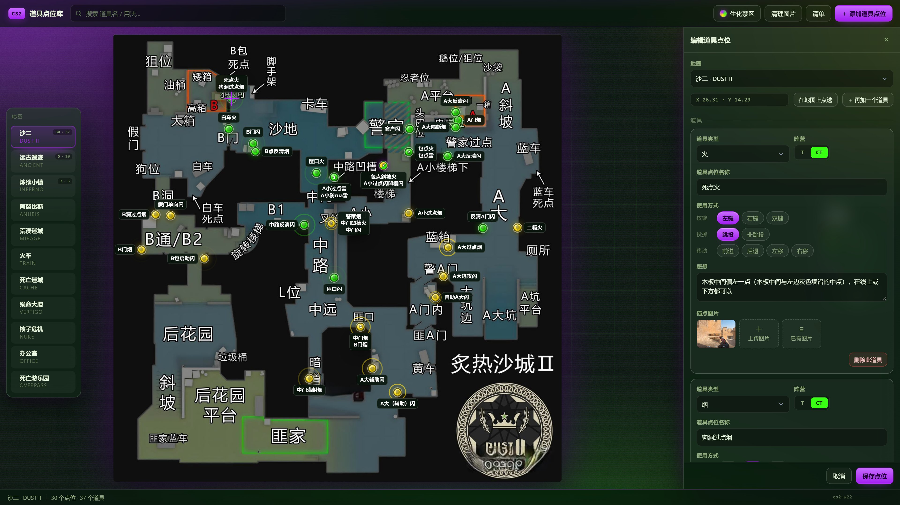

**按名称搜索**：命中的标记保持高亮，其余降低不透明度。

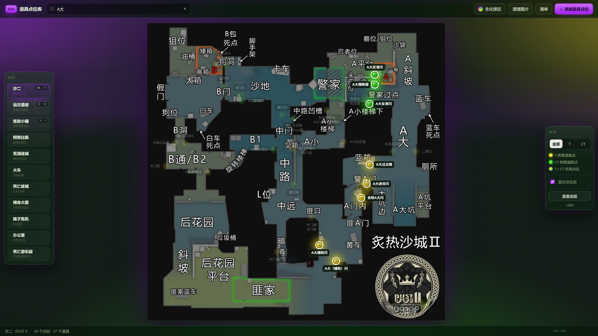

**当前地图的点位清单**

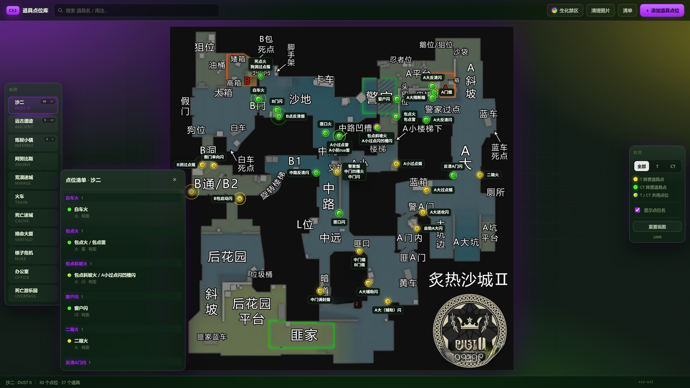

## 主题

内置 7 套深色主题，通过工具栏的「主题」按钮悬停展开切换，选择保存在 `localStorage`，按 `T` 循环切换。下方每张图对应同一张地图、同一批点位在不同主题下的效果。

| **鎏金夜航** `aurum` | **霓虹废墟** `neon` |
|:--:|:--:|
| 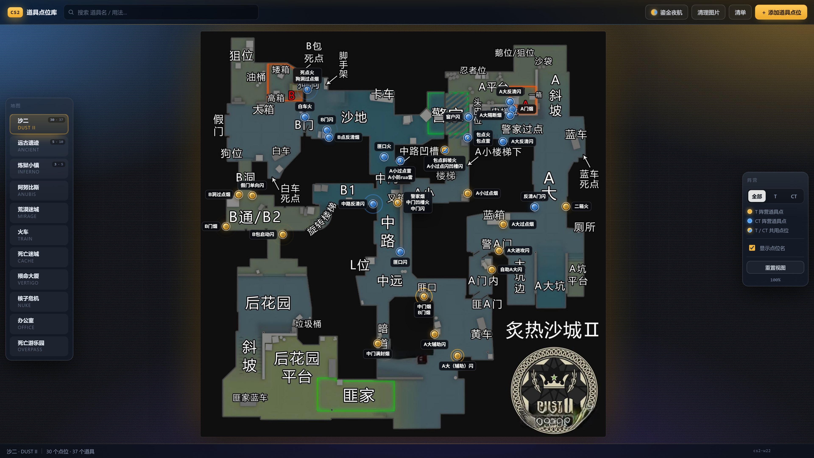 | 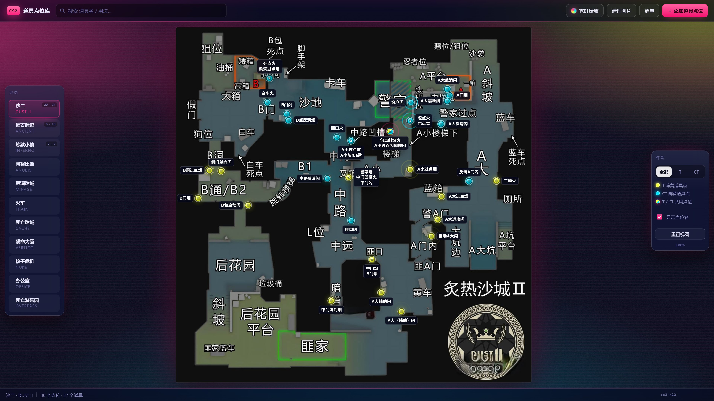 |
| **密林潜行** `verdant` | **熔岩裂谷** `magma` |
| 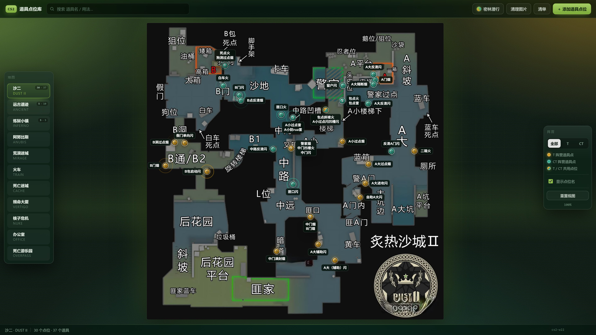 | 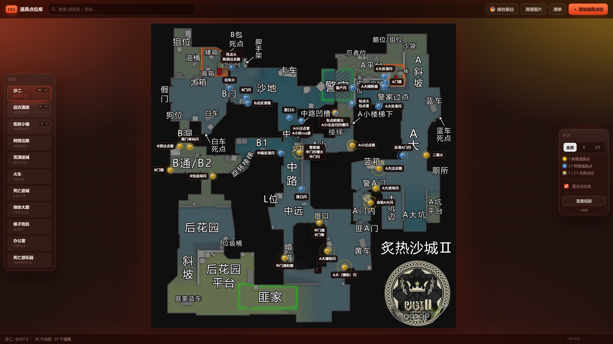 |
| **极地冰川** `glacier` | **紫电风暴** `violet` |
| 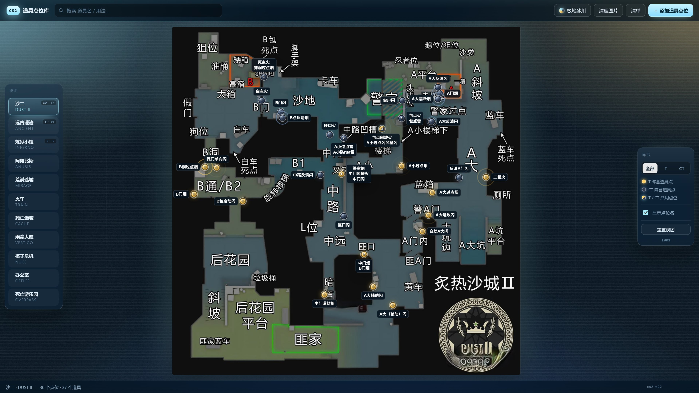 | 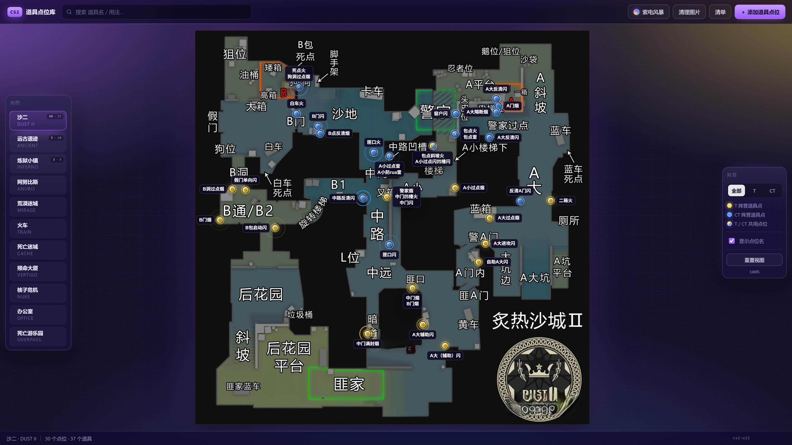 |
| **生化禁区** `toxic` | **主题下拉列表** |
|  | 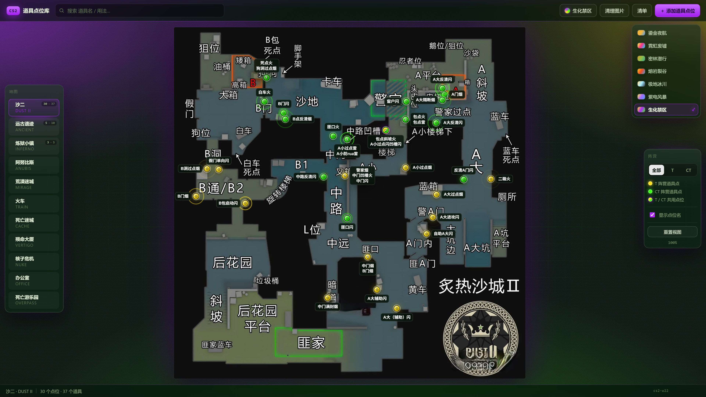 |

每套主题的阵营色独立定义：T 方固定使用黄色系，CT 方使用黄色系以外的冷色，保证两方在任何主题下都可区分。

## 功能

**雷达图标注。** 坐标以地图图片的百分比存储，与缩放级别和屏幕分辨率无关。地图支持滚轮缩放与拖拽平移。

**站位与道具分离。** 一个站位可挂载多个道具，标记右上角显示道具数量，查看器左侧按道具切换，无需为同一位置的多个道具重复打点。

**使用方式结构化。** 每个道具分别记录按键（左键、右键、双键）、投掷（跳投、非跳投）、移动（前进、后退、左移、右移），三项独立可选。

**描点截图。** 每个道具可挂载任意数量的截图，由本地服务写入 `resource/props/`，按「道具名-序号」自动命名，重名自动递增序号。查看器支持箭头、圆点、拖动与双击全屏。

**阵营标注与筛选。** 道具标记为 T、CT 或两者共用，标记颜色随阵营变化，右侧栏可将当前地图筛为单方视角。

**点位名标签自动避让。** 标签在屏幕坐标中排版，先排除与其它标记或已放置标签重叠的方向，再在剩余方向中选择朝向最近地图边的一侧。

**全字段搜索。** 匹配范围包含道具名称、感想与使用方式；未命中的标记降低不透明度而非隐藏，保留周边参照。

**图片清理。** 扫描 `resource/props/` 中已无道具引用的文件，二次确认后删除。

**写入前备份。** 每次保存 `data.json` 时，上一版本自动保留为 `data.json.bak`。

## 运行

环境要求：Python 3.8 或更高版本（仅使用标准库），Chromium 内核浏览器。

```bash
git clone https://github.com/nc3021/cs-prop-spots.git
cd cs-prop-spots
python server.py
```

访问 <http://127.0.0.1:8778/>。

服务只监听 `127.0.0.1`，端口固定为 8778。数据写入与图片上传均经由该服务完成，因此页面需要通过上述地址访问。端口被占用时服务直接退出（退出码 0），可重复启动，也可加入开机启动项。

Windows 提供了无窗口启动脚本：

```bat
start-server.bat
```

使用前需修改文件顶部的 `set "PY=..."`，将其指向本机的 `python.exe`。

## 添加点位

1. 按 `N`，或点击工具栏的「＋ 添加道具点位」。
2. 在左侧地图栏选择地图。
3. 点击「在地图上点选」，在地图上点击站位坐标，百分比数值自动填入。
4. 填写道具类型（烟、闪、火、雷）、名称、阵营，以及按键、投掷、移动三项。
5. 将截图拖入图片区或点击上传，文件即时写入 `resource/props/`。
6. 点击「保存点位」写入 `data.json`，上一版本保留为 `data.json.bak`。

修改点位：点击标记打开查看器，点击「编辑」。删除点位在查看器底部，删除前同样会保留备份。

## 快捷键

| 按键 | 作用 |
|---|---|
| `/` | 聚焦搜索框 |
| `N` | 新建点位 |
| `T` | 切换到下一套主题 |
| `Esc` | 逐层关闭浮层（全屏大图 → 主题菜单 → 选图 → 查看器 → 编辑面板 → 清单） |

## 数据格式

`data.json` 是唯一的数据文件，服务端写回时统一使用两空格缩进，便于手工编辑与版本对比。

```json
{
  "meta": { "version": 3, "updated": "2026-10-24T08:47:46.659Z", "app": "cs2-props" },
  "mapOrder": ["dust2", "ancient", "inferno"],
  "spots": [
    {
      "id": "s_muf7pyb51qria",
      "map": "dust2",
      "x": 6.24,
      "y": 48.08,
      "props": [
        {
          "id": "p_muf7pyb509eid",
          "side": "T",
          "type": "smoke",
          "name": "B门烟",
          "keys": ["left"],
          "toss": ["nojump"],
          "move": [],
          "note": "在左侧房顶柱子尖的小窗口里，在右上侧横线的上五分之二处，需要挨着线",
          "imgs": ["resource/props/B门烟-2.jpg"]
        }
      ]
    }
  ]
}
```

| 字段 | 含义 |
|---|---|
| `spots[].x` / `y` | 地图图片的百分比坐标（0–100），与分辨率无关 |
| `props[].side` | `T`、`CT`、`both`（共用） |
| `props[].type` | `smoke` 烟、`flash` 闪、`fire` 火、`he` 雷 |
| `props[].keys` | `left` 左键、`right` 右键、`both` 双键 |
| `props[].toss` | `jump` 跳投、`nojump` 非跳投 |
| `props[].move` | `fwd`、`back`、`left`、`right`，可多选 |
| `props[].imgs` | 相对项目根目录的图片路径 |
| `mapOrder` | 左侧地图栏顺序，属于界面偏好，不属于点位数据 |

站位的阵营由其下道具推导：全部为 T 时记为 T 点，全部为 CT 时记为 CT 点，两者都存在时标记为共用。

## 本地服务接口

`server.py` 提供六个接口，全部只对本机开放：

| 方法 | 路径 | 说明 |
|---|---|---|
| `GET` | `/api/ping` | 可用性探测，返回 `ok`、`dataExists`、`propsDir` |
| `GET` | `/api/data` | 返回 `data.json` 原始内容 |
| `POST` | `/api/data` | 校验并规范化后原子写入（`os.replace`），旧版本保留为 `data.json.bak` |
| `GET` | `/api/images` | 列出 `resource/props/` 下的图片文件名 |
| `POST` | `/api/upload` | 请求体为图片原始字节，文件名通过 `X-Filename` 头传递，上限 32 MB |
| `POST` | `/api/images/delete` | `{"names":[...]}`，仅接受纯文件名，拒绝路径穿越 |

写操作会校验 `Origin`，只接受 `127.0.0.1:8778` 与 `localhost:8778`。其余路径按静态文件返回。所有响应都带 `Cache-Control: no-store`，修改文件后刷新页面即可看到结果。

## 目录结构

```
index.html              唯一页面
assets/theme.css        颜色令牌、背景视效层、7 套深色主题
assets/style.css        布局与组件样式，全部使用令牌
assets/app.js           全部逻辑，无框架无构建
server.py               本地服务：静态文件 + JSON / 图片持久化
start-server.bat        Windows 无窗口启动脚本
data.json               数据集（点位、道具、地图顺序）
resource/maps/          11 张地图雷达图
resource/props/         描点截图
docs/screenshots/       README 使用的演示图
backup/                 改动前副本，已在 .gitignore 中忽略
```

## 已知限制

- **单人单机。** 一个 `data.json`，无多用户、无同步、无冲突合并。跨机器使用时拷贝该文件，避免两端同时编辑。
- **地图列表写在代码中。** 新增地图需在 `assets/app.js` 的 `MAPS` 数组添加条目，并将雷达图放入 `resource/maps/`。
- **缓存需要手动失效。** 修改 CSS 或 JavaScript 后，需同步更新 `index.html` 中的三处 `?v=` 与状态栏 `#statVer` 文本。
- **`start-server.bat` 面向 Windows。** 应用本身跨平台，该脚本与无窗口启动方式仅适用于 Windows。
- **雷达图不在 MIT 协议范围内。** 版权归 Valve，详见免责声明。

## 常见问题

**如何在多台机器之间同步数据？**
拷贝 `data.json` 与 `resource/props/` 目录。项目不含自动同步，两端同时编辑会产生不一致。

**误删点位如何处理？**
`data.json.bak` 保存上一个版本。停止服务后，将 `.bak` 覆盖回 `data.json`。

**为什么不使用数据库？**
数据量小且以人工整理为主，纯文本文件可以直接编辑、对比与版本管理，无需迁移脚本。

**描点图的命名规则是什么？**
上传时按「道具名-序号」生成文件名，序号取当前可用的最小值，不覆盖已有文件。文件名中的非法字符替换为下划线。

**如何新增或替换地图？**
在 `assets/app.js` 的 `MAPS` 中增加条目（id、中英文名、文件名、原始尺寸），将雷达图放入 `resource/maps/`。坐标按百分比存储，更换同比例的地图无需调整点位。

## 参与贡献

欢迎提交 Issue 与 Pull Request。除笔误修正外，建议先开 Issue 确认方案，再提交代码。

- [报告 Bug](https://github.com/nc3021/cs-prop-spots/issues/new?template=bug_report.yml)
- [提功能建议](https://github.com/nc3021/cs-prop-spots/issues/new?template=feature_request.yml)
- [查看已有 Issue](https://github.com/nc3021/cs-prop-spots/issues)

项目保持零依赖：不引入框架、npm 包与 CDN 资源。界面文案使用简体中文，代码注释保持同一语言。

## 开源协议

[MIT](LICENSE) © 2026 nc3021

## 免责声明

Counter-Strike 2 及其地图雷达图、相关素材的商标与版权归 Valve Corporation 所有。本项目为非商业的个人工具，MIT 协议仅覆盖代码。`resource/maps/` 中的地图图片与 `resource/props/` 中的游戏截图作为个人参考一并附带，不构成再授权。如需用于公开服务，请替换上述素材，或确认使用方式在所在司法辖区属于合理使用。
